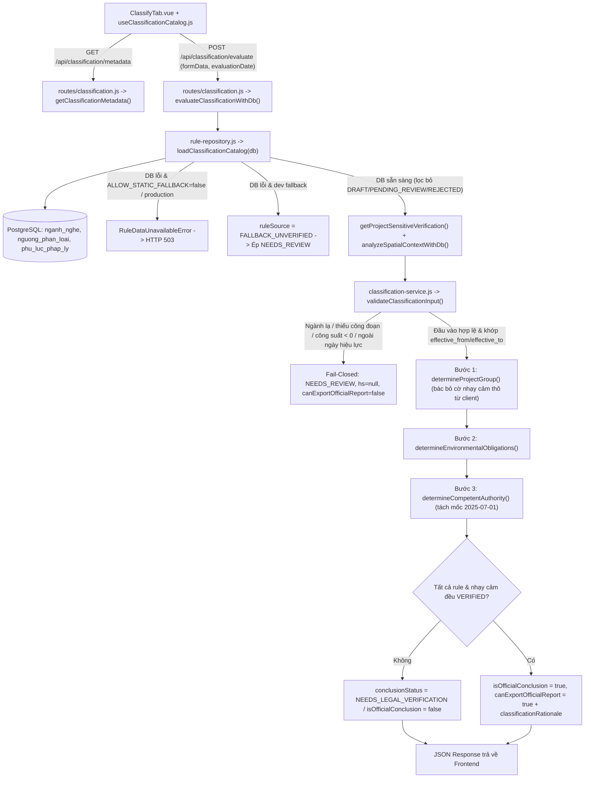
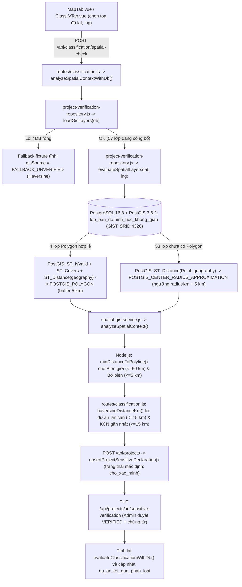
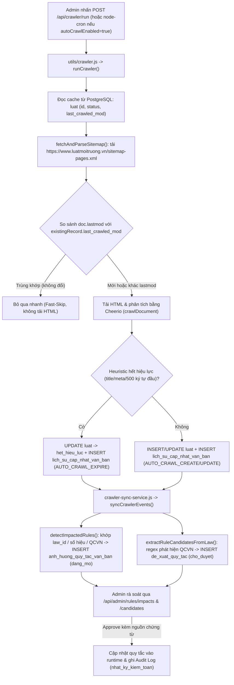

# Kiến trúc Hệ thống và Luồng Dữ liệu Chi tiết (`Architecture_And_Data_Flows.md`)

> **Commit baseline:** `69b39e3`  
> **Nguyên tắc:** Mọi nút trong sơ đồ dưới đây đều ánh xạ trực tiếp tới tên file, hàm và bảng/view đã kiểm chứng trong mã nguồn hiện tại.

---

## 1. Kiến trúc 4 Tầng & Ranh giới Trách nhiệm

1. **Tầng Giao diện (`frontend/src/`):** Vue 3 + Vite + Leaflet. Không tự chốt kết quả pháp lý hay trạng thái tuân thủ để lưu DB; luôn nạp danh mục từ REST API (`useClassificationCatalog.js` gọi `GET /api/classification/metadata`).
2. **Tầng Định tuyến & Bảo mật (`backend/routes/`, `backend/middleware/auth.js`):** Express 4.19.2, xác thực JWT lưu trong cookie `HttpOnly`, phân quyền `requireAuth` (`401`) và `requireAdmin` (`403`). Tuyến `POST /api/projects` và `POST /api/qcvns/samples` luôn tính toán lại trên máy chủ (*Server-Authoritative*).
3. **Tầng Nghiệp vụ (`backend/services/`, `backend/utils/`):** Động cơ phân loại 3 bước, bộ đánh giá QCVN, dịch vụ GIS, crawler & đồng bộ đề xuất, nhắc hạn tuân thủ (`node-cron`).
4. **Tầng Dữ liệu (`PostgreSQL 16.8 + PostGIS 3.6.2`):** 19 bảng vật lý chuẩn tiếng Việt kèm view tương thích tên tiếng Anh (`vietnamese-schema.js`), cột hình học `SRID 4326` đánh chỉ mục `GiST` và 2 trigger đồng bộ tọa độ/GeoJSON (`project-verification-repository.js`).

---

## 2. Luồng A — Phân loại Hồ sơ Môi trường & Xác định Thẩm quyền

**Điểm đọc DB & Nơi thực hiện phép tính (Luồng A):**
- **PostgreSQL:** Lưu trữ danh mục ngành, ngưỡng, ngày hiệu lực (`hieu_luc_tu`, `hieu_luc_den`), trạng thái công bố/xác minh và bản ghi xác minh yếu tố nhạy cảm (`xac_minh_yeu_to_nhay_cam_du_an`).
- **Backend Node.js (`classification-service.js` & `classification-rule-helpers.js`):** Thực hiện toàn bộ kiểm tra biên đầu vào (`validateClassificationInput`), lọc ngày hiệu lực (`isEffectiveOnDate`), so sánh ngưỡng `>` / `>=` (`matchesThreshold`), suy diễn 3 bước và tạo khối giải trình (`classificationRationale`).
- **Truy vết đầu ra (`classification-service.js`, `l.953–1001`):** Kết quả trả về có các trường cấu trúc `ref`, `ref_law_id`, `phuluc`, `appliedRuleVersion`, `appliedEffectiveFrom`, `appliedEffectiveTo`, `ruleSource`, `verificationStatus`, `sensitiveVerificationStatus`, `classificationRationale` (`matchedMin`, `matchedMax`, `legalRefs`, `adjustments`, `summaryText`). **Lưu ý kiểm toán:** Output hiện chưa trả `threshold_id` (`nguong_phan_loai.ma`) của từng dòng ngưỡng cụ thể ở cấp đầu ra JSON (được ghi nhận là `GAP` nhẹ trong `Legal_Rule_Traceability_Template.md`).

---

## 3. Luồng B — Phân tích Không gian GIS & Xác minh Vùng nhạy cảm

**Phân ranh giới chính xác nơi xử lý phép tính không gian:**

| Phép tính không gian | Nơi thực hiện | Hàm / Toán tử thực tế trong mã nguồn |
| :--- | :---: | :--- |
| Kiểm tra đa giác hợp lệ & điểm thuộc đa giác (4 lớp mẫu: `vqg_cat_tien`, `kdt_can_gio`, `kcn_hiep_phuoc`, `kcn_vsip_1`) | **PostgreSQL / PostGIS** | `ST_IsValid(hinh_hoc_khong_gian)`, `ST_Covers(hinh_hoc_khong_gian, ST_SetSRID(ST_MakePoint($2, $1), 4326))` (`project-verification-repository.js`, `l.497–498`) |
| Khoảng cách trắc địa tới ranh giới đa giác hoặc tâm 53 lớp điểm trong `lop_ban_do` | **PostgreSQL / PostGIS** | `ST_Distance(...::geography, ...::geography) / 1000.0` (`project-verification-repository.js`, `l.500–502`) |
| Khoảng cách tới đường biên giới đất liền (`<= 50 km`) và đường bờ biển (`<= 5 km`) | **Backend Node.js** | `minDistanceToPolyline()` dùng `pointToSegmentDistanceKm()` (`spatial-gis-service.js`, `l.283–288`) |
| Lọc vùng nhạy cảm phát hiện (`inCore` và vùng đệm) & KCN gần nhất (`<= 15 km`) | **Backend Node.js** | `bufferThreshold = hasPolygon ? 5 : zone.radiusKm + 5` (`l.306`), `nearestKcn.distanceKm <= 15` (`l.400`) |
| Tìm dự án lân cận trong bán kính `15 km` | **Backend Node.js** | `haversineDistanceKm(lat, lng, pLat, pLng) <= 15` (`routes/classification.js`, `l.85–86`) |
| Dự phòng khi PostGIS không khả dụng hoặc lỗi truy vấn | **Backend Node.js** | `haversineDistanceKm()` kèm cờ `gisSource = 'FALLBACK_UNVERIFIED'` và `spatialMethod = 'HAVERSINE_APPROXIMATION'` |

---

## 4. Luồng C — Thu thập Văn bản Pháp luật (Crawler) & Kiểm duyệt Quy tắc

**Lưu ý kiểm toán quan trọng ở Luồng C:**
- **Cơ chế phát hiện thay đổi:** Crawler hiện tại dùng **`doc.lastmod` trong Sitemap XML so với cột `last_crawled_mod`** trong bảng `luat` — **KHÔNG dùng giá trị băm SHA-256** nội dung văn bản (xác nhận `0` dòng SHA-256 trong `backend/utils/crawler.js` và `backend/services/crawler-sync-service.js`).
- **Giới hạn phân tích ngữ nghĩa:** Việc phát hiện văn bản hết hiệu lực sử dụng từ khóa heuristic trên tiêu đề, thẻ `meta description` và `500` ký tự đầu (`crawler.js`, `l.140–150`); việc phát hiện quy tắc bị ảnh hưởng dựa trên khớp `law_id`, số hiệu `so` và regex `QCVN` (`crawler-sync-service.js`, `l.11–123`). Crawler **không** tự phân tích điều khoản chuyển tiếp và **không** tự ghi đè quy tắc runtime đã công bố.
